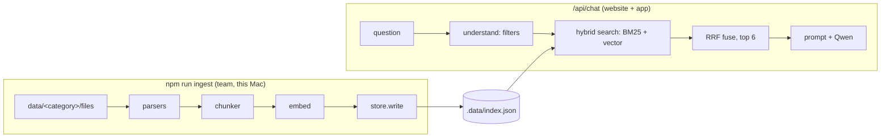
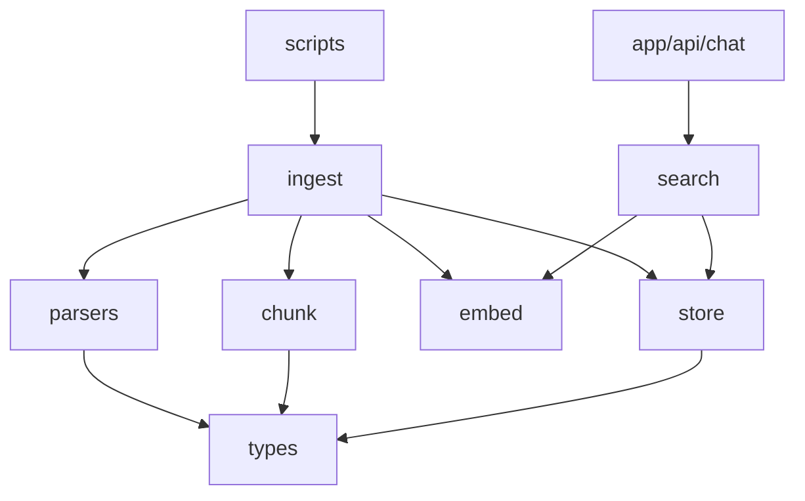

# Architecture Spine — Ummah One RAG knowledge base

## Design Paradigm

Pipes-and-filters. Two pipelines share one Chunk shape and one store.



| Layer | Directory |
|---|---|
| Parsers (format → sections) | `website/lib/rag/parsers/` |
| Chunk, embed, ingest | `website/lib/rag/ingest.ts`, `chunk.ts`, `embed.ts` |
| Store | `website/lib/rag/store.ts` |
| Search | `website/lib/rag/search.ts` |
| Scripts | `website/scripts/ingest.ts`, `website/scripts/eval.ts` |



Dependencies point down only. Parsers never import store or search.

## Invariants & Rules

### AD-1 — One Chunk shape

- **Binds:** all
- **Prevents:** parsers or stores each adding their own fields.
- **Rule:** `Chunk = { id, category, file, title, section, text, meta: { region?, country?, city? }, source, hash, vector }`, defined once in `lib/rag/types.ts`.

### AD-2 — Parsers output sections only

- **Binds:** CAP-1, CAP-7
- **Prevents:** format logic leaking into chunking or search.
- **Rule:** each parser is `(path) => Section[]` with `Section = { headingPath: string[], text }`. Markdown/txt: headings. PDF: page text, with headings detected where possible. Word: headings via HTML. Excel/CSV: one section per row, with column names in the text. A file that yields no text throws `Unreadable`.

### AD-3 — Category from the folder, place from headings

- **Binds:** CAP-1, CAP-3
- **Prevents:** guessing categories from content.
- **Rule:** category = the first folder under `website/data/`. Region, country and city come only from headings (`# Region — …`, `## City, Country`) or an optional `<file>.meta.json`.

### AD-4 — The index is a build output

- **Binds:** CAP-1, CAP-5
- **Prevents:** the server and the scripts writing the index in different ways.
- **Rule:** only `ingest` writes `website/.data/index.json`; the server only reads it, and reloads when the file changes. Only chunks whose `hash` changed are re-embedded. The index stores the embed model name, and a mismatch forces a full rebuild.

### AD-5 — Hybrid retrieval

- **Binds:** CAP-2, CAP-3, CAP-6
- **Prevents:** each caller ranking differently.
- **Rule:**
  - `search(query, {k=6})`: run BM25 and cosine over the chunks that pass the filters, then fuse with reciprocal rank fusion (k=60).
  - Filters are city, country, region and category names found in the question (English + Arabic map). With no filter match, search everything.

### AD-6 — Store interface

- **Binds:** CAP-1, CAP-2
- **Prevents:** the Supabase move rewriting search.
- **Rule:** `ChunkStore { load(): Chunk[]; write(chunks) }`. The local JSON store is used now; a pgvector store comes later with the same Chunk shape.

### AD-7 — Embeddings

- **Binds:** CAP-2
- **Prevents:** queries and documents embedded differently.
- **Rule:** use Ollama `/api/embed` with model `OLLAMA_EMBED_MODEL` (default `qwen3-embedding:0.6b`). Queries are prefixed `Instruct: Given a travel or study question, retrieve passages that answer it\nQuery: `; documents get no prefix.

### AD-8 — Blocked places

- **Binds:** all
- **Prevents:** a removed place coming back with new data.
- **Rule:**
  - The list lives in `lib/rag/blocked.ts` (Grozny, Makhachkala, Derbent, Srinagar, Erbil, Lahore).
  - Ingest fails if a blocked place is a heading, and warns if one is mentioned in text.
  - Search drops chunks titled with a blocked place.

### AD-9 — IDs and sources

- **Binds:** CAP-4
- **Prevents:** sources changing names on every re-ingest.
- **Rule:** id = `category/file#slug(headingPath)`; source = `<file> › <section> — to verify`.

### AD-10 — Eval

- **Binds:** CAP-5
- **Prevents:** quality dropping unnoticed after new data.
- **Rule:** `website/eval/questions.json` holds `[{ q, expect: [title substrings] }]`. `npm run eval` prints hit@6 and lists failures. Target: 90% or more (estimate).

## Consistency Conventions

| Concern | Convention |
| --- | --- |
| Files | Data in `website/data/<category>/`. Category folder names are lower-case English (travel, education, culture, food, clothes, heritage, handicraft, business) |
| Errors | Ingest prints a report (added / changed / removed / unreadable / warnings) and exits non-zero on failure |
| Config | `OLLAMA_URL`, `OLLAMA_MODEL`, `OLLAMA_VISION_MODEL`, `OLLAMA_EMBED_MODEL` in `.env.local` |
| Labels | Every source shows "to verify" |

## Stack

| Name | Version |
| --- | --- |
| Next.js / React | 15.5.4 / 19.1 [ADOPTED] |
| Node | 24.14.1 |
| Ollama | 0.40.16 [ADOPTED] |
| Chat model | qwen3:4b-instruct [ADOPTED] |
| Embedding model | qwen3-embedding:0.6b |
| PDF | unpdf 1.9.1 |
| Word | mammoth 1.13.0 |
| Excel | exceljs 4.4.0 |
| CSV | papaparse 5.7.0 |

## Structural Seed

```text
website/
  data/travel/ALL-81-CITIES.md   # team data, one folder per category
  .data/index.json               # built by ingest (not committed)
  lib/rag/  types.ts blocked.ts parsers/ chunk.ts embed.ts store.ts search.ts ingest.ts
  scripts/  ingest.ts eval.ts
  eval/questions.json
```

[ASSUMPTION] A chunk is one heading section, split at paragraph boundaries above ~1,200 characters.
[ASSUMPTION] Brute-force cosine over the JSON index is fast enough up to ~50k chunks.

## Capability → Architecture Map

| Capability | Lives in | Governed by |
| --- | --- | --- |
| CAP-1 add data, one command | scripts/ingest.ts, ingest.ts | AD-3, AD-4 |
| CAP-2 search by meaning | search.ts, embed.ts | AD-5, AD-7 |
| CAP-3 filters | search.ts | AD-3, AD-5 |
| CAP-4 sources | types.ts, route.ts | AD-9 |
| CAP-5 eval | scripts/eval.ts | AD-10 |
| CAP-6 best passages | search.ts | AD-5 |
| CAP-7 any file type | parsers/ | AD-2 |

## Deferred

- Supabase pgvector store: when keys arrive (AD-6 keeps it a swap).
- OCR for scanned PDFs: reported as unreadable until needed.
- Reranker model: add only if eval stays under target.
- Hosting server: before launch (Q13).
- Education sample data from prompt.md: stays as code entries until the team adds an education file.
